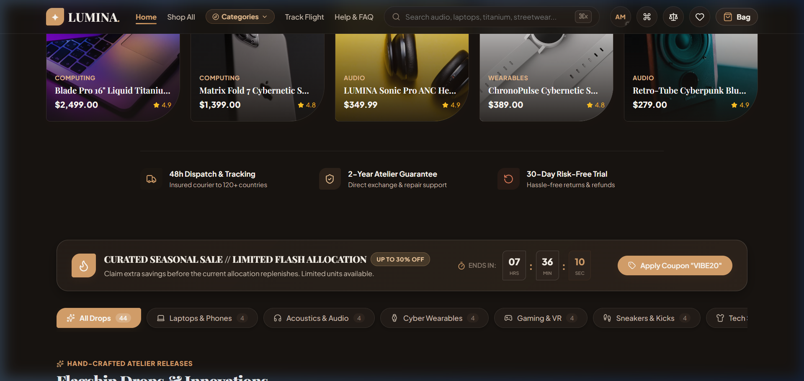
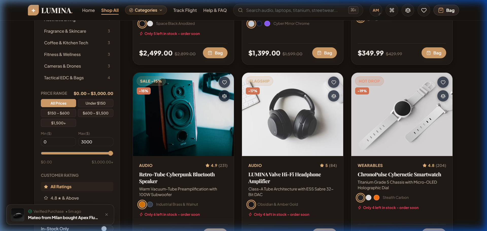
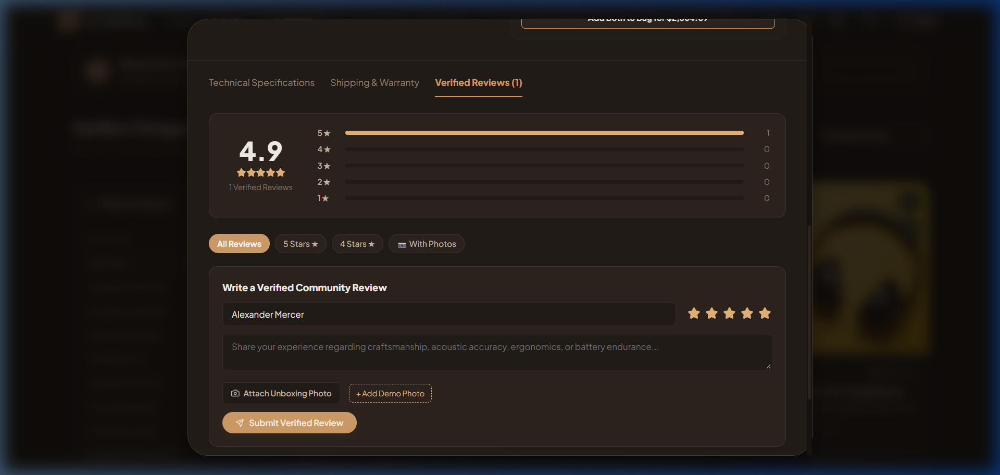
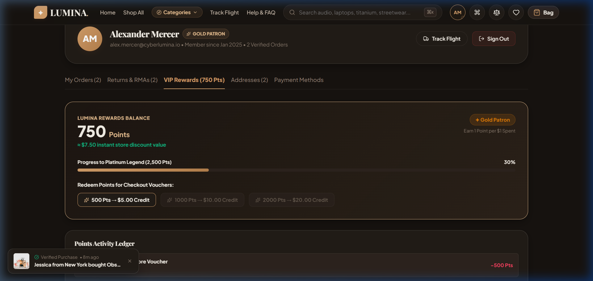
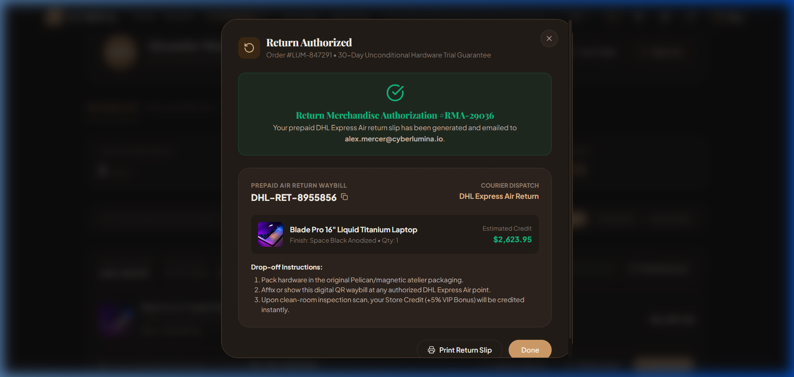
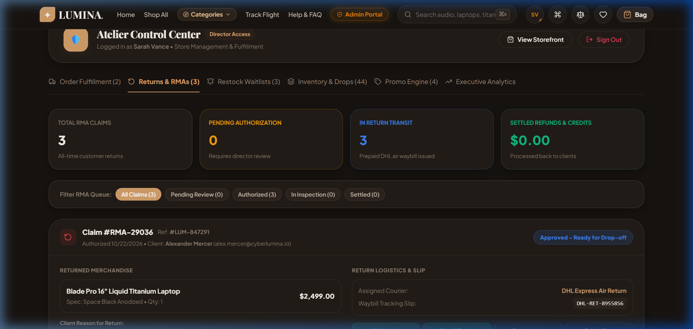

# LUMINA Atelier — Cyberpunk Luxury E-Commerce Platform

<div align="center">


**LUMINA Atelier** is a state-of-the-art, high-performance e-commerce platform built for limited-edition cybernetic hardware, luxury audio, computing drops, and tech streetwear. Featuring a bespoke glassmorphic design system, tactile audio feedback, self-service return logistics, VIP loyalty gamification, and an executive administrative portal.

[Explore Live Drops](#-platform-highlights) • [Screenshots](#-visual-showcase) • [Tech Stack](#-technology-stack) • [Quick Start](#-quick-start) • [Demo Accounts](#-demo-accounts)

</div>

---

## 📸 Visual Showcase

### 1. Homepage & Curated Drop Showcase
Sleek glassmorphic navigation bar with global keyboard shortcuts (`⌘K` / `/`), live ticker announcement, and dark/light luxury theme engine.



---

### 2. Atelier Storefront Drops & Filter Architecture
Real-time category navigation, price sliders, stock status toggles, rating filters, view-mode switcher (Grid 4 / Grid 3 / List), and instant typo-tolerant search.



---

### 3. Verified Photo Reviews & Star Rating Distribution
Detailed breakdown of customer satisfaction across 5-star spectrum, photo-verified reviews, filter pills, and optimistic "Helpful (👍 X)" upvoting.



---

### 4. VIP Loyalty Points Ledger & Voucher Redemption
Amazon-grade client portal with live loyalty points balance, tiered progress bar (Silver Member → Gold Patron → Platinum Legend), instant 1-click voucher redemptions ($5, $10, $20), and audit ledger.



---

### 5. Self-Service Order Returns & DHL Air Waybill Portal (RMA)
Clients can initiate return authorizations directly within their 14-day window. Includes reason selection, store credit incentive (+5% VIP bonus) vs card refund, and an official printable DHL Express Air return waybill slip.



---

### 6. Atelier Director Control Center & Operations
Executive management suite with real-time order fulfillment, RMA claim lifecycle approvals, product stock/price adjustments, and 1-click restock waitlist broadcasting to waiting clients.



---

## ✨ Platform Highlights & Features

### 🛍️ Client Experience & Purchasing
- **Self-Service Returns & Refunds (RMA)**: 3-step return request modal with instant printable DHL Express waybill slip and +5% VIP bonus store credit incentive.
- **Priority Restock Waitlist**: When drops sell out, buttons transition to "Waitlist 🔔", allowing customers to queue for restock notifications with variant choices.
- **Customer Photo Reviews**: Star distribution bars (5★ through 1★), photo uploads, filter pills, and community helpfulness voting.
- **VIP Loyalty Rewards Ledger**: Earn 1 point per $1 spent on every purchase; redeem points for instant checkout discount vouchers (`VIP5`, `VIP10`, `VIP20`).
- **Abandoned Cart Recovery**: Floating slide-in recovery drawer prompting buyers with a `DROP10` 10% discount code to resume checkout.
- **Typo-Tolerant Search & Recent History**: Instant search matching with 1-char Levenshtein tolerance, multi-word matching, and recent search history chips with 1-click clear.
- **Multi-Currency Converter**: Real-time currency conversions across USD ($), EUR (€), GBP (£), and JPY (¥).
- **Tactile Audio Feedback**: Sound synthesis for adds, removals, checkouts, and UI interactions using the Web Audio API.

### 🛡️ Administrative Control Center
- **Order Fulfillment Pipeline**: Real-time courier flight tracking updates (Confirmed → Packed → Air Transit → Delivered).
- **RMA Claim Authorization Queue**: Review incoming return claims, authorize waybills, mark depot receipt, and dispatch credits.
- **Restock Waitlist Management**: Monitor customer demand per out-of-stock item and broadcast drop alerts with 1 click.
- **Catalog Drop Engine**: Instant stock level adjustments, live price editing, drop creation, and promotional coupon engine.

---

## 🛠️ Technology Stack

| Domain | Technology |
|---|---|
| **Framework** | [React 19](https://react.dev/) + [Vite 8](https://vitejs.dev/) |
| **Styling** | Vanilla CSS Token System with Glassmorphism & Theme Variables |
| **State Management** | React Context (`StoreContext`) with `localStorage` Persistence |
| **Icons** | [Lucide React](https://lucide.dev/) |
| **Animations & Confetti** | Canvas Confetti & CSS3 GPU-accelerated Keyframes |
| **Audio Engine** | Custom Web Audio API synthesizer (`soundManager`) |
| **Code Splitting** | Dynamic `React.lazy()` chunking with `<Suspense>` |
| **Testing** | Node.js Native Test Runner (`node --test`) |
| **Linting** | [Oxlint](https://oxc.rs/) (0 errors, 0 warnings) |

---

## 🚀 Quick Start

### 1. Prerequisites
- [Node.js](https://nodejs.org/) (v18.0.0 or higher recommended)
- `npm` or `pnpm`

### 2. Installation
```bash
git clone https://github.com/your-username/lumina-ecommerce.git
cd lumina-ecommerce
npm install
```

### 3. Development Server
Start the local Vite development server with Hot Module Replacement (HMR):
```bash
npm run dev
```
Open [http://localhost:5173](http://localhost:5173) in your browser.

### 4. Running Unit Tests
Execute the automated test suite covering currency conversion, catalog integrity, RMA calculations, and VIP points logic:
```bash
npm test
```

### 5. Running the Linter
```bash
npm run lint
```

### 6. Production Build
Build the optimized production bundle with dynamic chunking:
```bash
npm run build
```

---

## 👥 Demo Accounts

The application includes pre-configured 1-click demo accounts for testing all customer and administrative workflows:

| Role | Name | Email | Password | Access Level |
|---|---|---|---|---|
| **VIP Customer** | Alexander Mercer | `alex.mercer@cyberlumina.io` | `password123` | Gold Patron, 1,250 Pts, Past Orders, Active RMA |
| **Atelier Director** | Sarah Vance | `sarah.vance@lumina.luxury` | `admin123` | Full Control Center, RMA approvals, Waitlists |

---

## 📦 Pushing to GitHub

To publish this project to your GitHub account:

```bash
# 1. Initialize git (if not already initialized)
git init

# 2. Add all files including the screenshots folder
git add .

# 3. Commit the changes
git commit -m "feat: complete LUMINA Atelier commercial platform with screenshots and documentation"

# 4. Link your remote GitHub repository
git remote add origin https://github.com/<your-username>/<your-repo-name>.git

# 5. Push to main branch
git branch -M main
git push -u origin main
```

---

## 📄 License

This project is licensed under the [MIT License](LICENSE).
